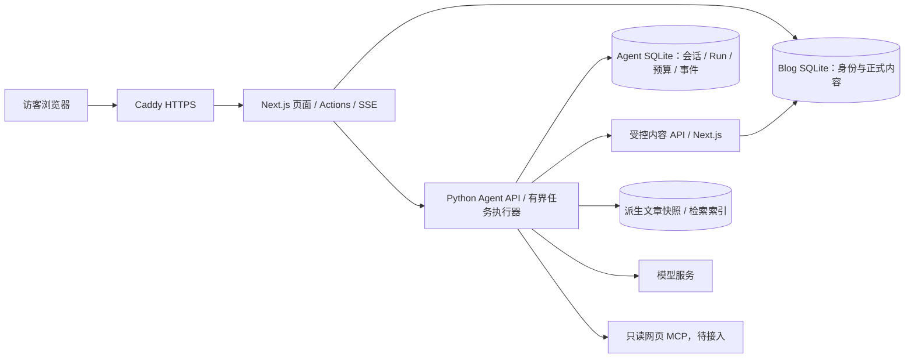

# 集成架构基线 v1

日期：2026-10-26；性质：集成设计，已交付I1-F开发预览和Agent配置/checkpoint基础，运行连接仍待实施。目标是单机、有限并发、可恢复的作品集问答入口，不以“稳定”代替实际验收。

## 1. 已核实的基础与缺口

| 源码证据 | 当前事实 | 接入工作 |
| --- | --- | --- |
| Blog `package.json`、`docker-compose.yml`、`Caddyfile` | Next 16.2.10、Prisma 7、SQLite、Caddy，已有单站容器部署配置 | 扩展同机私网部署，保留原博客卷 |
| Blog `prisma/schema.prisma`、`src/lib/auth.ts` | 双语 Post/Project、单管理员 iron-session；无访客身份/会话表 | 新增独立访客主体、限流；保持管理员身份独立 |
| Blog `src/app/api/` | 当前只有图片上传 route | 尚无 Agent/文章集成 API |
| Agent `code/blog_assistant/session.py:create_conversation` | 直接构建 SamplePosts；已有 retriever 注入 | 增加文章来源 seam，不从 HTTP 请求传入文件目录 |
| Agent `code/blog_assistant/tools.py` | BlogTools 统一权限/参数检查，tools 调用本地 posts | 保留执行层校验，增加网站内容 adapter |
| Agent `code/agent_core/conversation.py` | submit/resume_turn、状态保存、reasoning/compact callbacks | 增加受控公开事件与取消生命周期；reasoning callback 不能直接公开 |
| Agent `requirements.txt` | openai、dotenv、rich、tiktoken；没有 Web server | HTTP adapter、容器和依赖审批尚待落地 |

现有 CLI 的 `qa/manage` 只是模式，并非网站认证。现有状态 JSON、Trace、缓存不能直接作为访客多租户存储。最新预算和压缩工程已存在，但真实模型质量/费用/连续性仍待验收，见唯一台账。

## 2. 拓扑与所有权

仅 Caddy 暴露公网 80/443。Next 与 Python 使用不同持久卷、服务身份及权限。Python **不挂载 blog.db**，不使用管理员 cookie；公开服务不挂载本机 `Blog/`、研究资料或 CLI 会话。

## 3. 三个深模块

| Module | 小 Interface | Implementation 所隐藏的复杂性 |
| --- | --- | --- |
| 网站访问模块 | `createConversation / submit / cancel / close / snapshot / events` | 身份验证、所有权、CSRF、请求约束、Agent 转发、错误脱敏 |
| Agent 运行模块 | `startRun / cancelRun / getSnapshot / replayEvents` | 幂等、单会话互斥、预算预留与结算、检查点、工具执行与公开事件 |
| 文章来源模块 | `list / search / read / validateVersions` | 本地 adapter 与网站 adapter 的差异、语言、版本、可见性、索引过期与来源核验 |

文章来源 seam 有两个实际 adapter：CLI 保留本地 Markdown；Web 只允许网站内容。保留原 `find_file/find_text` 的本地行为；Web 工具表移除文件路径工具，以文章 ID 与章节定位，避免给公网暴露目录能力。无需重写通用核心或新增通用“插件系统”。

建议新增位置（均待实现）：

- Blog：`src/app/(site)/assistant/`、`src/components/assistant/`、`src/lib/assistant/`、`src/app/api/assistant/`、`src/app/api/internal/agent-content/`；交互 UI 可为 client，GSAP 仅放 `components/motion/`。
- Agent：`code/blog_assistant/web/`（HTTP、运行注册表、事件投影）、`code/blog_assistant/content_sources/`（本地/网站 adapter）。共享核心仅增加必要可注入 hooks，不带网站身份逻辑。

## 4. 数据归属与事务

| 存储 | 写入者 | 内容与约束 |
| --- | --- | --- |
| Blog SQLite，经 Prisma 单例 | Next.js | 现有 Post/Project/User；拟增 Visitor、AccessBucket；后续 Proposal/Approval/Outbox |
| Agent runtime.sqlite，经 Python store | Agent | Conversation、Run、Message、Event、BudgetReservation、预算日账本、checkpoint revision |
| Agent 检索缓存/正文快照 | 内容同步器 | 仅已发布文章的派生数据，带 site/post/locale/revision；可重建 |
| 既有 CLI JSON 与 artifacts | CLI | 保留原格式及目录，不自动迁移到公开 Web 会话 |

Web RuntimeStore 把兼容核心的 state JSON 作为 checkpoint blob 存在 Agent SQLite 中，配合 revision 乐观校验；不要让 JSON 文件与数据库分别成为权威。运行状态、公开消息、终态事件、预算结算尽量在同一短事务提交。模型调用和网络请求在事务外执行。实现前验证现有 store.save 调用位置及 artifact_store 对 `store.path` 的依赖，提供受控的独立 artifacts 目录，不能假设替换 store 就完全兼容。

关键唯一约束：`(owner, conversationId, clientRequestId)`、`(runId, seq)`、每 conversation 至多一条 active run。数据库事务负责提交竞争；进程内锁仅优化，不能作为唯一防重手段。一个 Agent 实例、一个任务执行器，SQLite WAL + busy_timeout、短写事务；不启动多个 Uvicorn worker 争用同一内存任务表。

## 5. 内容读取与撤回

首个端到端切片可用小语料关键词搜索，结果仍回源读取。后续复用现有 MiniLM/BM25，按网站 API 构建独立快照和索引，禁止用个人本机目录替代真实网站数据。

内容 API 每次限定 `PUBLISHED`，在服务端产生不透明 revision（包含发布状态、内容、语言及结构版本）；不能仅凭客户端 URL 或 mtime 判断版本。分页使用绑定快照/版本的 cursor；期间变化返回失效并重取。首版可定时完整 manifest 对账处理删除，后续用事务 outbox 增量事件降低延迟。

索引只给候选，不是可见性的权威。工具交付正文前回源验证；旧会话上下文、摘要、缓存和引用再次使用前都验证 revision。网站不可达时关闭博客证据问答，不能继续吐出旧缓存正文；联网通路是否可用独立标注。

回答发送前再次校验引用集合。历史 snapshot 和事件重放同样过滤已失效来源关联的整个回答及正文片段，返回“内容已失效”占位；不能只删来源链接而保留旧正文。生成中撤回：取消对应 run、撤销未提交答复并发 invalidated 事件；已发到用户设备的文字无法收回。V1 为严格内容门禁，**文章答案先缓冲核验再交付**，可通过 SSE 分块传送已核验答案，不称作实时 token 流；实时 token 模式只有接受这项撤回窗口并完成测试后再开放。历史再展示始终重验；引用集记录实际用过的所有正文依赖，不只末尾列出的引用。

## 6. 身份、公开权限与安全

访客使用独立签名/加密 HttpOnly、Secure、SameSite=Lax cookie，对应服务端 Visitor 随机 ID 与期限；管理员沿用现有 session，但每次管理动作仍校验有效用户。浏览器提供的 owner、mode、budget、文章状态一律不可信。

Next 认证后生成内部短期签名上下文，包含 subject、scope、audience、requestId、issuedAt、expiresAt；方法、路径、body hash 一并签名，服务端限制时钟偏差与重放。双向调用使用不同服务密钥。Python 只接受指定服务身份，scope 固定 `qa:published`，不把该标记视为管理授权。GET 订阅和恢复也校验 owner，不只检查创建请求。

公开模型工具仅有发布内容读取和审核过的只读网页工具，不提供 shell、任意 URL fetch、任意文件读取或发布能力。MCP 服务固定配置，对任意 URL 工具需阻断内网/回环/link-local、重定向绕过与 DNS rebinding；无法保证时只开放固定搜索提供方。网页/文章视为数据，正文指令不能改变执行权限。

匿名 cookie 可清除，不能承诺强身份防刷。单主体额度之外加入受信代理后的 IP 段速率、全站并发和每日硬成本上限；只信任 Caddy 覆写的转发头。IP 日志采用短期 HMAC 标识，不保存聊天正文。可疑流量先关入口，后续再评估登录/挑战机制。

## 7. 管理链路第二阶段

`/admin/assistant` 独立 conversation/scope，先处理站主显式提交的一篇 Markdown；生成独立 Proposal，记录 baseRevision、原稿、处理稿与差异。用户审阅后经 Server Action 校验 session/版本/审批对象，在 Blog 事务中应用一次并记审计/outbox；Agent 不自行调用发布写接口。审批绑定 proposal hash，内容变更需重新审批；冲突返回 409，不覆盖较新的编辑。

单篇翻译/摘要/排版/阅读时长通过后再做批量。META/MGMT 其余需求保留，不用此次接入顺手做分类系统、自动发文或知识库全量迁移。

## 8. 选择理由与限度

保留 Next.js 页面与 Python 核心能复用现有能力；分数据库避免双语言同时修改正式文章；持久 Run + SSE 允许刷新/断连后恢复读取，避免长请求绑住网页生命周期。单机 SQLite 与有限队列满足首版部署目标，未来多实例/写竞争持续出现再以测量证据迁移外部队列与数据库；本轮不引入 Redis、PostgreSQL 或 Kubernetes。

协议依据：[Next.js 自托管流式说明](https://nextjs.org/docs/app/guides/self-hosting)、[Caddy reverse_proxy](https://caddyserver.com/docs/caddyfile/directives/reverse_proxy)、[SQLite WAL](https://www.sqlite.org/wal.html)。官方行为只支持选型判断，不构成本项目实测结果。
