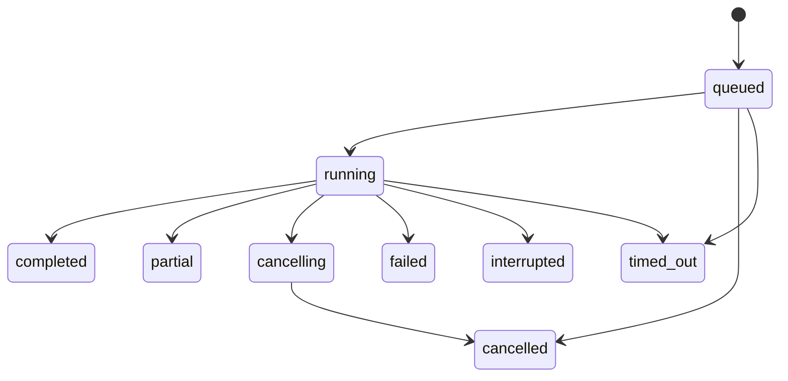

# 前后端契约 v1（设计，待实现）

## 1. 浏览器与 Next.js

写命令全部为 Server Actions，先创建/验证 visitor session、校验 Origin/会话所有权及输入，再调用服务端模块。管理动作使用 requireAdmin；页面 layout 守卫不能代替动作鉴权。SSE 使用 Node runtime Route Handler，不经 Server Action 长时间返回流。

| Action / GET | 输入 | 成功结果 |
| --- | --- | --- |
| `createConversation` | locale，固定的 capabilities 选择（只能取服务端允许值） | conversationId、expiresAt、snapshot |
| `submitMessage` | conversationId、clientRequestId、text、可选 contextPostId | runId、messageId、state；已存在同请求返回原 run |
| `cancelRun` | conversationId、runId | cancelling 或已有终态 |
| `closeConversation` | conversationId | closed；原子标记关闭并申请取消 active run |
| `restartConversation` | closed conversationId | 新 conversationId；继承主体额度与降级阶段 |
| `GET /api/assistant/conversations/{id}` | cookie | 消息、activeRun、额度阶段、cursor、expiresAt |
| `GET /api/assistant/runs/{id}/events?after={seq}` | cookie、非负 cursor | SSE；仅所属主体可读 |

`contextPostId` 仅提示当前文章，不允许浏览器提交正文作为“本站证据”。用户消息是用户输入，不能改变来源权限。首版输入上限建议 8,000 字符且请求体不超过 32 KiB，UI 显示剩余输入长度；与 Agent 内部 512 KiB 模型输入窗口、32,000 本地 article tokens 是不同限制。最终数值在预发布配置中冻结。

统一错误：`{code, retryable, requestId, retryAfterSeconds?}`，文案由 en/zh 字典映射。不回传原始异常、trace、模型密钥或文件路径。GET 使用 HTTP 状态；Actions 返回等价 tagged result。

| code | HTTP 类比 | UI 行为 |
| --- | --- | --- |
| UNAUTHENTICATED / FORBIDDEN | 401/403 | 提示不可访问，避免泄露其他 conversation 是否存在 |
| NOT_FOUND / EXPIRED | 404/410 | 保留可见提示，引导显式新建；额度不重置 |
| INVALID_INPUT | 400 | 定位输入错误，保留草稿 |
| RUN_ACTIVE / IDEMPOTENCY_CONFLICT | 409 | 恢复当前 run，或用新 clientRequestId |
| RATE_LIMITED / BUDGET_EXHAUSTED | 429 | 展示服务端阶段/等待时间，停止自动重试 |
| AGENT_UNAVAILABLE / CONTENT_UNAVAILABLE | 503 | 不静默换成无来源的博客回答 |

## 2. Next.js 与 Python 私网

建议内部 `/v1/conversations` POST、`/v1/conversations/{id}/runs` POST、`/v1/runs/{id}/cancel` POST、`/v1/conversations/{id}/close` POST、conversation snapshot GET、run events GET。所有调用包含 architecture.md 中签名身份上下文，Python 校验 ownership 和 scope。请求/响应携带 `contractVersion: 1`；不兼容版本在准入时拒绝。

submit 内部正文固定为 `{conversationId, clientRequestId, text, locale, contextPostId?}`；subject 与 scope 来自验证后的签名 envelope，不来自用户正文。run ID 由服务端生成。`clientRequestId` 在同一会话内唯一，并保存规范化 payload hash：相同 ID/相同内容返回原 run；相同 ID/不同内容拒绝。网络超时后先查同 ID，**禁止自动换 ID 重跑**；用户显式重试失败回答才创建新 ID，并展示额外费用可能发生。

只读文章 API（Next.js）：

| Endpoint | 合约 |
| --- | --- |
| `GET /api/internal/agent-content/manifest` | snapshotId、cursor、已发布 postId/locale/revision；分页完成前不替换旧索引 |
| `GET /api/internal/agent-content/posts/{id}?locale=…` | postId、slug、canonicalUrl、requestedLocale、contentLocale、fallback、title、excerpt、contentMarkdown、tags[]、publishedAt、updatedAt、revision |
| `POST /api/internal/agent-content/validate` | 有界 `{postId, locale, revision}[]`，返回 valid/changed/unavailable；只验证，不执行业务写入 |
| `GET /api/internal/agent-content/search?q=…` | V1 有界关键词候选；正文仍经 read/validate |

内容语言与 UI 语言分离：英文为空时返回中文且 `fallback=true/contentLocale=zh`，不得伪造已翻译内容。站点 canonical URL 在服务端构造；日期以 ISO UTC 交换，publishedAt 为空不推测源发布日期。现有 tags 字符串由 adapter 规范化为数组。分类、来源 URL、阅读时长暂为可选字段，待 META migration 后启用。

## 3. 持久事件

SSE `id` 为该 run 的单调 seq，数据统一 envelope：

```json
{
  "contractVersion": 1,
  "conversationId": "server-generated-id",
  "runId": "server-generated-id",
  "seq": 12,
  "type": "phase.changed",
  "occurredAt": "2026-10-26T00:00:00Z",
  "data": { "phase": "reading", "sourceCount": 2 }
}
```

允许事件：`run.accepted`、`phase.changed`、`sources.updated`、`answer.delta`、`answer.committed`、`answer.invalidated`、`budget.changed`、`run.terminal`。phase 只允许 queued/retrieving/reading/generating/validating；没有真实 hook 不生成对应事件。不得把 on_reasoning 原文包装成 phase。

`answer.delta` 带 messageId、offset、text；首版仅传已核验答案的分块。`answer.committed` 带最终 messageId、text、sources、finishReason、completeness（complete/partial）；以此替换暂存文本，而不是再追加一条。sources 包含 postId/locale/revision/title/url/sectionId/sectionTitle，网页来源则为真实 URL/title/retrievedAt/type=web；不可用章节锚点时链接文章，不编造 hash 链接。

先事务落库再推送；前端按 `(runId, seq)` 去重。终态事件和 run 终态在同事务提交。客户端看到 terminal 后关闭 EventSource，不在正常结束后无限重连。断线从 Last-Event-ID 或显式 after 续接；首次刷新先取 snapshot 和一致性 cursor，再订阅大于 cursor 的事件。cursor 越界或事件保留期已过返回 RESET_REQUIRED，重新拉 snapshot，不能启动新模型请求。限制每主体连接数、慢消费者缓冲和重放批量；溢出主动断开后续接。

响应 `Content-Type: text/event-stream`、`Cache-Control: private, no-store, no-transform`；15 秒注释心跳，无事件时不伪造进度。历史事件经来源有效性过滤后再发；内部原始 trace 与公开事件存储分开。协议依据：[MDN SSE](https://developer.mozilla.org/en-US/docs/Web/API/Server-sent_events/Using_server-sent_events)。

## 4. 状态机、恢复与预算



completed 仅代表通过终态检查的完整答案；partial 保留有效内容并展示缺失原因。重启时 active run 先标 interrupted；不自动再次执行不确定已付费的模型调用。用户显式恢复时沿用原 run/checkpoint/剩余额度；若阶段不可安全恢复，要求创建关联的新 run，保留旧耗费。

Conversation 的 active/closed/expired 与 Run 状态、主体额度 normal/warned/fallback/blocked 分开。停止生成取消当前 run；退出关闭 conversation；额度阶段绑定 owner/day，不因新对话、退出或刷新归零。

准入事务同时取得会话 active slot、全局 slot/有界 queue slot 和预算 reservation。Agent 是模型/MCP 消耗的唯一计费账本，Next 只管入口请求速率。每次模型、摘要、修复、重试、MCP 调用前预留最坏成本；计价配置未设置或输入/输出不可界定时拒绝新付费调用。结束按 provider usage 结算；无 usage、网络结果不明、取消后迟到调用保守保留预留额并记录 unknown，不自动退款。缓存命中按实际账单信息，不把本地 token 估算当 provider usage。

取消操作先持久 cancelRequested/关闭标志，再中断任务；每个外部调用前后检查，迟到输出不能写入公开消息。已发送上游请求可能仍计费，取消不承诺退费。HTTP 断连只断订阅，不自动取消已接受 run；在有限时长和额度内继续，刷新可恢复。终态不可被迟到完成回调改写。
